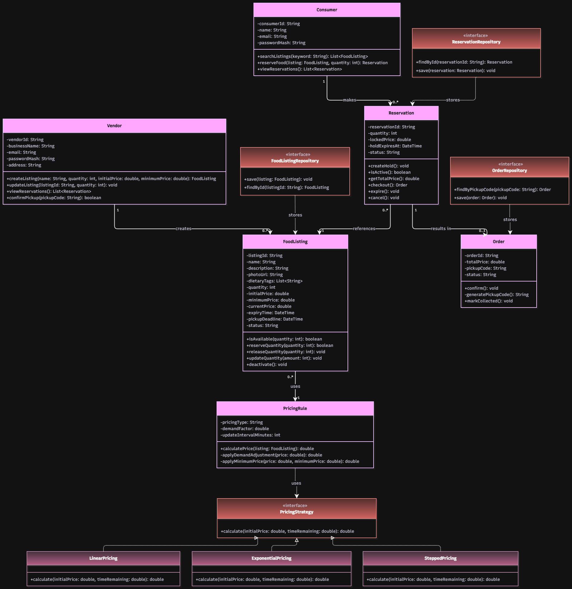

# EchoEats: UML Class Diagram

**Owner:** Jude (Person 3)

- `echoeats-class-diagram.drawio`: editable source (open in draw.io / app.diagrams.net)
- `echoeats-class-diagram.png`: exported image

## Explanation

The diagram has six main classes. A **Vendor** creates many **FoodListings**, views reservations and confirms pickups with the consumer's pickup code. Each listing stores its description, photo, dietary tags, quantity, initial, minimum and current price, expiry time, pickup deadline and status. Its methods `isAvailable()`, `reserveQuantity()` and `releaseQuantity()` make sure stock never goes negative and that expired or deactivated listings cannot be reserved. A **Consumer** searches listings and makes many **Reservations**. Each reservation belongs to one consumer, refers to one food listing, and stores the reserved quantity, a locked price and a `holdExpiresAt` time 15 minutes after it is created. If the consumer completes the simulated checkout while the hold is still active, the reservation results in one **Order** (0..1) with a unique pickup code. Otherwise the hold expires and the reserved stock is released. Consumers and vendors both have an email and password hash for secure login. The design also includes the two patterns chosen in the architecture analysis. Each FoodListing uses one **PricingRule**, which calculates the discounted price through the **PricingStrategy** interface (Strategy pattern). LinearPricing, ExponentialPricing and SteppedPricing each implement it, and the result is adjusted for demand and never goes below the vendor's minimum price. The **FoodListingRepository**, **ReservationRepository** and **OrderRepository** interfaces store and retrieve these objects (Repository pattern), keeping database access separate from the business rules.

This design supports the main EchoEats requirements. Dynamic pricing is handled by PricingRule and its three strategies (US-V05). Inventory is managed through FoodListing's quantity and `updateQuantity()` (US-V03). Reservations lock the price and quantity for 15 minutes so the same food cannot be booked twice (US-C05). Orders and pickup codes let vendors track and confirm pickups (US-V06).
